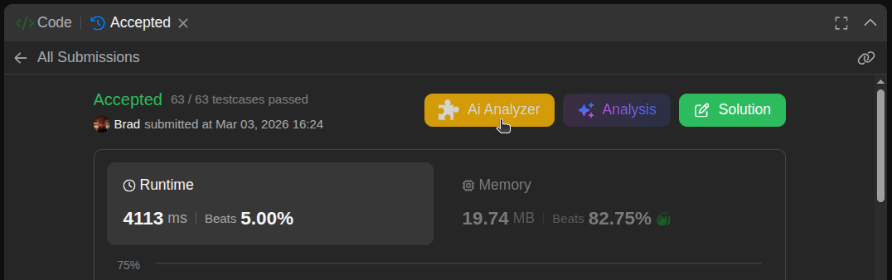

# DSA Analyzer

Free browser extension for DSA practice: the features platforms lack or are locked behind a paywall, including schedule planning, solved-problem analytics, progress sharing, and code reviews such as complexity analysis, readability feedback and much more...

---

## Features

- **Complexity Analysis**: Evaluates time and space complexity of submitted code.
- **Readability & Style**: Feedback on code formatting, naming conventions, and structure.
- **Improvement Suggestions**: Actionable recommendations for edge cases, performance optimizations, and idiomatic approaches.
- **LeetCode Integration**: Seamlessly works on LeetCode submission pages.
- **Secure Key Storage**: Securely stores your API credentials using `chrome.storage`.

---

## Getting Started

### Prerequisites

- [Node.js](https://nodejs.org/) (v18 or higher recommended)
- [npm](https://www.npmjs.com/)
- Google Chrome (or Chromium-based browser)

### Local Setup

1. **Clone the repository**:
   ```sh
   git clone https://github.com/aniTech-addict/Dsa-reviewer-extension.git
   cd Dsa-reviewer-extension
   ```

2. **Install dependencies**:
   ```sh
   npm install
   ```

3. **Build the extension**:
   ```sh
   npm run build
   ```
   The generated extension files will be in the `dist/` directory.

4. **Load the extension into Chrome**:
   - Open Chrome and navigate to `chrome://extensions/`.
   - Enable **Developer mode** (toggle in the top-right corner).
   - Click **Load unpacked** and select the generated `dist/` directory (or the project root for development).
   - The DSA Analyzer icon will now appear in your browser toolbar!

---

## Project Structure

```text
├── build/             # Build scripts to bundle into dist/
├── constants/         # Application constants & config
├── content_script/    # Script injected into LeetCode submission pages
├── images/            # Icons and preview screenshots
├── prompts/           # LLM prompt templates for code review
├── test/              # Test inputs and sample runners
├── utils/             # Helper utilities
├── workers/           # Background service workers and API handlers
├── index.html         # Extension popup HTML
├── index.css          # Extension popup styles
├── index.js           # Extension popup script
└── manifest.json      # Chrome extension manifest (v3)
```

---

## Testing

> [!NOTE]
> **Current Status**: Testing is currently handled through manual checks. The current focus is to develop some base for the extension before committing time for a dedicated testing branch.
>
> **Planned**: Playwright testing is planned and soon will be integrated by the end of NOV 2026.

### Manual Testing

1. Navigate to a LeetCode submission page (e.g., `https://leetcode.com/submissions/detail/1234567890/`).
   
2. Click the extension's icon in your browser toolbar.
3. The extension's background script will access the code for analysis when triggered.
4. Open Developer Tools (`F12`) and check the console for logs and results from the background script.

### Automated Checks

To run the local analysis test runner with sample inputs:

```sh
npm test
# or
node test/test_v1.js
```

Check `test/result/` for test output and results.

---

## Usage

Once set up, navigate to a LeetCode submission page. The extension's background script will be able to access the code for analysis when triggered via the browser toolbar icon.

---

## Demo

Watch the demo on YouTube: [DSA Analyzer Demo](https://www.youtube.com/watch?v=vVKgUXFcBTM)

---

## Contributing

Contributions are warmly welcomed! Whether you're fixing a bug, improving prompt templates, enhancing the UI, or adding/suggesting new features, your help is appreciated.

### How to Contribute

1. **Fork the repository** on GitHub.
2. **Clone your fork** locally:
   ```sh
   git clone https://github.com/<your-username>/Dsa-reviewer-extension.git
   cd Dsa-reviewer-extension
   ```
3. **Create a new branch** for your feature or bug fix:
   ```sh
   git checkout -b feature/amazing-feature
   # or
   git checkout -b fix/issue-description
   ```
4. **Make your changes** and test locally:
   - Run `npm run build` to confirm the extension builds cleanly.
   - Test the unpacked extension in Chrome.
5. **Commit your changes**:
   ```sh
   git commit -m "feat: add support for new feature"
   ```
6. **Push to your branch**:
   ```sh
   git push origin feature/amazing-feature
   ```
7. **Open a Pull Request** against the `main` branch with a clear description of your changes.

### Good Areas to Contribute

- Improving prompts in `prompts/` for richer, more actionable feedback.
- Enhancing popup UI/UX in `index.html` and `index.css`.
- Adding support for more submission platforms (e.g. HackerRank, Codeforces).
- Preparing scenarios for upcoming Playwright E2E test integration.

---

## License

This project is licensed under the [MIT License](LICENSE).
